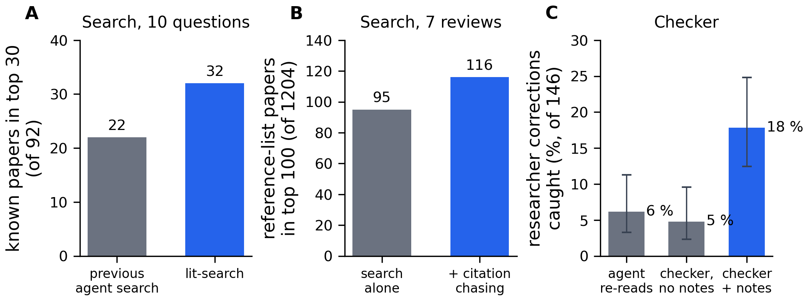

# research-skills

Four Claude Code plugins for research work: literature search, claim checking, referee-style review and
writing rules. They come from the agent we run in a computational neuroscience lab, and we wrote each one
after the agent made the same mistake many times.



Measured on our lab's data. Panels A and B test lit-search, panel C the checker (95 % intervals).

## Install

In Claude Code:

```
/plugin marketplace add joverwiening/research-skills
/plugin install lit-search@research-skills
```

The other three are `checker`, `reviewers` and `writing-rules`.

For the Claude app, download a zip from [`claude-app/zips/`](claude-app/zips/) and upload it under
Customize > Skills > "+" > "Upload a skill". Skills need "Code execution and file creation" on in
Settings > Capabilities.

## lit-search

An agent asked for the literature usually searches once in its own words and cites from abstracts.
lit-search queries OpenAlex and arXiv with several phrasings, follows the references and citers of the
best hits, and ranks the pool against the question. A small model reads the top papers in full and returns
verbatim quotes, and code checks each quote against the paper text.

- 10 of our research questions, with the 92 papers our earlier searches had cited as targets: the top 30
  held 32 of them, our previous agent search 22. The targets came from a keyword search, which favours
  this ranking.
- 7 published reviews, with their 1204 references as targets: following citations raised the hits in the
  top 100 from 95 to 116.
- Full text was found for 887 of 1191 papers. On two test questions, all 157 quotes the reader returned
  were in the paper word for word.

## checker

A second agent checks a claim against the files it came from and the project's notes. Each objection has
to quote a file and line, and a hook looks the quote up.

We replayed 146 corrections a researcher had made to our agent. The checker with notes caught 18 % of
them, the checker without notes 5 %, and the agent re-reading its own message 6 %. Most errors still get
through, so a clean check does not show that a claim is right.

## reviewers

Two or three reviewer agents with different angles (story editor, skeptic, referee) first say what story
the results tell and what is missing. Then each item gets one verdict: main, fix, develop, supporting,
dead end or cut. Results with thin evidence get "develop" and a list of what they need. We built this
after our earlier reviewer, which could only keep or cut, took one of our figures from 7 panels to 3 in
one overnight run.

## writing-rules

Rules for papers, grant text and essays. Name the readers and outline the claims before writing, then
apply five sentence tests after Gopen and Swan. A lint flags words that tell the reader how to feel
("remarkably", "crucial", "delve") and runs after every write to a `.tex` or `.md` file.

## Requirements

- lit-search needs Node 20 or later, `pdftotext` (poppler) and a free OpenAlex API key in
  `OPENALEX_API_KEY`. The reader calls Haiku through `claude -p` on your Claude plan, or the API with
  `ANTHROPIC_API_KEY`. Each plugin's README lists what it sends where.
- With `JEV_API_KEY` set, lit-search ranks with Jev, a hosted relevance model. The 32 above is without
  it; the baseline of 22 was ranked with it.
- Hooks run only in Claude Code. The app versions have the instructions without the hooks, and
  `referee-review` runs one referee instead of several agents.
- Tested in Claude Code and the Claude app only.

## Credits and license

Part of the writing-rules ban list comes from BootLoops prose-lint by Matthew D. Schwartz (CC BY 4.0).
Code and text are MIT licensed.
